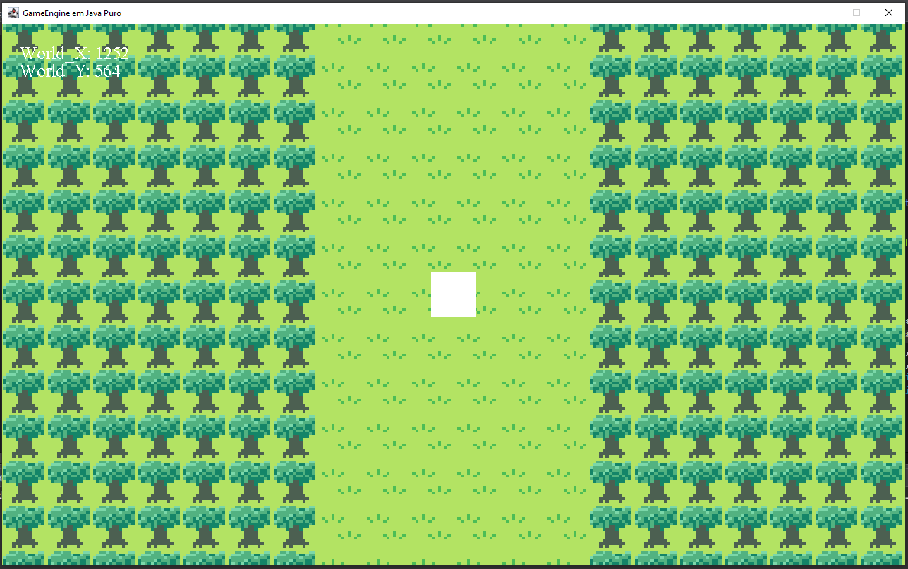

# Game Engine em Java Puro

Desenvolvi um jogo de RPG 2D com perspectiva Top-Down semelhante a jogos clássicos como The Legend of Zelda (1986), Dragon Quest (1986), Pokemon Fire Red (2004), utilizando apenas a linguagem Java e os recursos disponibilizados pelo JDK. Com o objetivo de praticar programação com a linguagem Java e implementar algoritmos e sistemas manualmente.

## Sistemas Implementados

Abaixo segue a lista de algoritmos e sistemas de jogos que foram implementados no jogo até o momento:

**Game Loop**: Utilizando um while eu implementei um loop de jogo que atualiza os quadros por segundo (FPS) em uma taxa contínua de **60 FPS**, e mantém o cálculo da lógica em uma taxa fixa de **120 FPS** por segundo. Com o objetivo de manter uma atualização suave e controles responsivos.

**Janela**: Através das bibliotecas *Swing* e *Awt*, implementei uma janela e um painel onde os gráficos do jogo são desenhados e exibidos para o usuário.

**Player**: Com OOP avançada, criei um objeto jogador que é capaz de se mover pela janela. Possuindo atributos e comportamentos herdados e próprios.

**Movimentação**: Um sistema capaz de receber, tratar e responder às entradas do usuário do teclado.

**Tiles**: Sistema de tiles e mundo quase completo, por enquanto possuindo apenas um mundo e renderizando 6 tipos de tiles diferentes.

**Câmera**: A câmera que permite a movimentação do jogador pelo mapa do jogo e um sistema de otimização que apenas renderiza os tiles que estão dentro do limite da tela.

## Próxima implementação

Próximo passo é finalizar os Sprites do jogador e adicionar colisões nos tiles.

## Estado atual

Foi implementado de forma semi-finalizada o sistema de tiles no jogo, onde os arquivos com as informações de cada tile é carregado no código, o spritesheet é carregado, redimensionado e recortado. Então o código lê o arquivo que representa o mapa do jogo, formado por vários números em sequência (50x50), e então os tiles são instanciados na memória e renderizados na tela em suas devida posições, definida pelo ID de cada tile.

Também foi implementado o sistema da câmera, onde o jogador pode se mover pelo mapa, além de um sistema de otimização que apenas renderiza os tiles que aparecem na tela.

## Diagrama de Classe:

## Lista de Objetivos:

✅ Game Loop (60 FPS, 120 UPS);

✅ Abrir uma janela;

✅ Renderizar um quadrado;

✅ Adicionar movimento ao quadrado via input;

✅ Sistema de Câmera

✅ Carregar configurações de tiles via txt;

✅ Instanciar e renderizar blocos;

✅ Carregar mapa via txt;

✅ Carregar Assets dos tiles;

❌ Inimigos;

❌ Sistema de combate;

❌ NPCs;

❌ Cidade;

❌ Sistema de missão;

❌ Chefe;

❌ Primeira versão "jogável";

## Build & Debug:

Clone este repositório:

    git clone https://github.com/NickyDeviley/JavaRPG.git

Salve o projeto em sua Workspace e abra utilizando sua IDE de preferência e versões do java 21+;

## Licença:

MIT License
