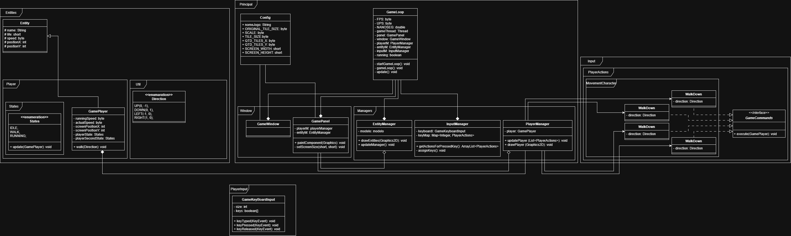

# Game Engine em Java Puro

Desenvolvi um jogo de RPG 2D com perspectiva Top-Down semelhante a jogos clássicos como The Legend of Zelda (1986), Dragon Quest (1986), Pokemon Fire Red (2004), utilizando apenas a linguagem Java e os recursos disponibilizados pelo JDK. Com o objetivo de praticar programação com a linguagem Java e implementar algoritmos e sistemas manualmente.

## Sistemas Implementados

Abaixo segue a lista de algoritmos e sistemas de jogos que foram implementados no jogo até o momento:

**Game Loop**: Utilizando um while eu implementei um loop de jogo que atualiza os quadros por segundo (FPS) em uma taxa contínua de **60 FPS**, e mantém o cálculo da lógica em uma taxa fixa de **120 FPS** por segundo. Com o objetivo de manter uma atualização suave e controles responsivos.

**Janela**: Através das bibliotecas *Swing* e *Awt*, implementei uma janela e um painel onde os gráficos do jogo são desenhados e exibidos para o usuário.

**Player**: Com OOP avançada, criei um objeto jogador que é capaz de se mover pela janela. Possuindo atributos e comportamentos herdados e próprios.

**Movimentação**: Um sistema capaz de receber, tratar e responder às entradas do usuário do teclado.

## Próxima implementação

Planejo implementar posteriormente um sistema de tiles, em que o jogo irá ler um arquivo de texto formado apenas por números e espaços, onde cada número representará um tile distinto que será renderizado. Além disso, utilizarei *Fly-weight Pattern* para diminuir o custo da memória com a criação dos objetos que representaram os Tiles, instanciando apenas um de cada na memória e reutilizando esse único objeto. Inicialmente utilizando apenas quadrados coloridos e seguidamente desenvolver uma arte apropriada para o jogo.

O sistema de câmera foi iniciado, mas só pode ser finalizado após a renderização do mapa.

## Estado atual

Consertado o sistema de movimentação do jogador, em que a corrida era sobreposta pelos próximos comandos de movimento. Agora o jogador possui um estado primário e um secundário, onde o primário trata-se de comportamentos concretos, que modificam diretamente atributos do jogador ou realizam ações, enquanto o estado secundário funciona como um suporte ao primeiro estado, modificando a maneira como ele é executado.

Também foi consertado o sistema de entradas, que causava uma exceção "NullPointerException" caso o usuário pressionasse alguma tecla que não estivesse mapeada em alguma ação. Agora utilizando uma ArrayList que registra o código de todas as teclas pressionadas. Agora a última tecla pressionada se sobressai em relação as outras. Evitando que os botões funcionem apenas em uma ordem específica.

## Diagrama de Classe:

## Lista de Objetivos:

✅ Game Loop (60 FPS, 120 UPS);

✅ Abrir uma janela;

✅ Renderizar um quadrado;

✅ Adicionar movimento ao quadrado via input;

❌ Sistema de Câmera

❌ Carregar configurações de tiles via txt;

❌ Instanciar e renderizar blocos;

❌ Carregar mapa via txt;

❌ Carregar Assets;

❌ Inimigos;

❌ Sistema de combate;

❌ NPCs;

❌ Cidade;

❌ Sistema de missão;

❌ Chefe;

❌ Primeira versão "jogável";

## Build & Debug:

Clone este repositório:

    git clone https://github.com/NickyDeviley/JavaRPG.git

Salve o projeto em sua Workspace e abra utilizando sua IDE de preferência e versões do java 21+;

## Licença:

MIT License
